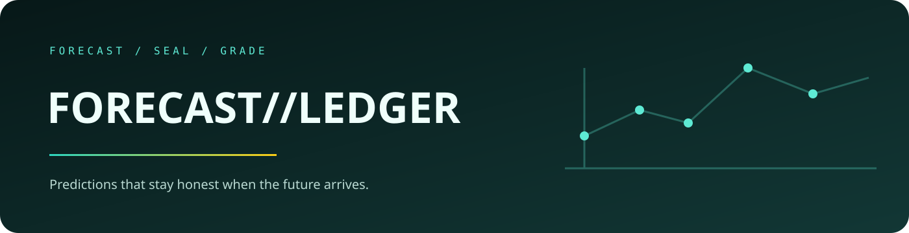

<p align="center">
  
</p>

<p align="center">
  <a href="https://jeevan-0508.github.io/Forecast-Ledger/">Open the live ledger</a> ·
  <a href="#the-forecast-lifecycle">Forecast lifecycle</a> ·
  <a href="#run-locally">Run locally</a>
</p>

# FORECAST//LEDGER

### A forecasting system that seals its predictions before the outcome exists.

Forecast Ledger separates the moment a forecast is made from the moment reality arrives. It seals the prediction, grades it later, and refuses to manufacture confidence when the history cannot support the evaluation protocol.

`SEALED FORECASTS` · `OUTCOME GRADING` · `REFUSAL TO OVERCLAIM` · `EUROSTAT`

## Start with the product

**[Open the live ledger →](https://jeevan-0508.github.io/Forecast-Ledger/)**

The current generated ledger contains a sealed EU27 retail-volume forecast and its evaluation state. The interface is small on purpose: the important thing is the boundary between what was known then and what is known now.

## The forecast lifecycle

<table>
  <tr>
    <td width="33%"><strong>01 · Seal</strong><br>Record the prediction and the information available at forecast time.</td>
    <td width="33%"><strong>02 · Wait</strong><br>Keep the outcome separate so hindsight cannot leak into the forecast.</td>
    <td width="33%"><strong>03 · Grade</strong><br>Compare the sealed claim with reality—or refuse if the protocol is unsupported.</td>
  </tr>
</table>

## Why it matters

Most forecasting demos know the answer before they make the prediction. Forecast Ledger makes the timing explicit so a good-looking chart cannot quietly become a misleading claim.

<details>
<summary><strong>Implementation notes</strong></summary>

The project is a Python-based, generated ledger backed by Eurostat data. Its evaluation policy, data provenance, and reproducible build details live below the product story in the repository documentation.

</details>

<details>
<summary><strong>Scope and limitations</strong></summary>

The current ledger is a small demonstrator, not a universal forecasting service. A refused forecast is an intentional result when the available history or evaluation window cannot support a defensible claim.

</details>

## Run locally

```bash
python3 -m venv .venv
python3 -m pip install -r requirements.txt
```

The repository currently does not bundle a product screenshot; use the live ledger above as the visual source of truth.

<p align="center"><sub>Built by <a href="https://github.com/Jeevan-0508">Jeevan Siddhabhaktula</a> · MIT licensed</sub></p>
